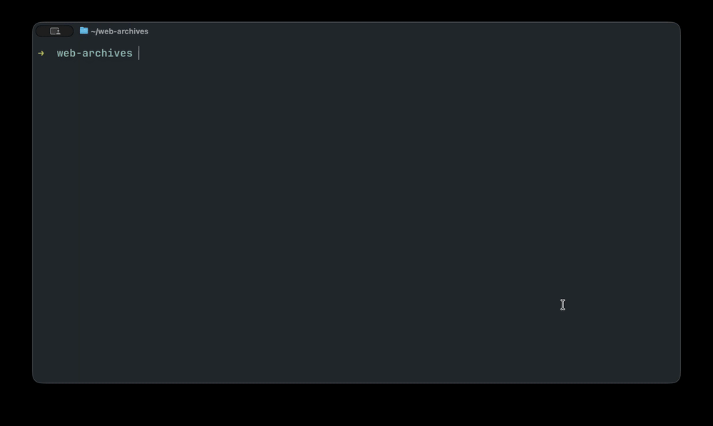

# btrix

Make high-fidelity web archives with [Browsertrix
Crawler](https://github.com/webrecorder/browsertrix-crawler) by telling your
favorite LLM what you want archived. Crawls run locally in a container and
produce WACZ files you can replay in [ReplayWeb.page](https://replayweb.page).



btrix also has a [project page](https://edsu.github.io/btrix/).

## Install

You need macOS or Linux, [Docker or Podman](https://docs.docker.com/get-docker/),
and Node 22.19+. On Windows, run btrix inside WSL2. Docker Desktop keeps its
engine there, and the crawler container expects the Linux paths WSL2 gives you.

```bash
npm install -g @edsu/btrix
btrix
```

On first run btrix asks you to connect a language model. Type `/login` to use a
Claude, ChatGPT or Copilot subscription, or `/endpoint` to connect an
[OpenAI-compatible API](#using-your-own-model-endpoint), such as a gateway or a
model running on your machine. You can also set an API key like
`ANTHROPIC_API_KEY` before you start btrix. Crawling needs no account.

btrix keeps your model credential and its own preferences in `~/.btrix`, apart
from anything else on the machine. Set `BTRIX_AGENT_DIR` to move them. If you
already use [pi](https://pi.dev) and want to share one login, point it at
`~/.pi/agent`.

btrix runs on the pi agent harness, which npm installs as a dependency. You don't
need to know anything about it. If you already use pi, you can load btrix as an
extension instead: `pi install git:github.com/edsu/btrix`.

## Use

`cd` to a working directory and run `btrix`. It opens with a summary of the
store and a suggested next step:

```
 _     _         _
| |__ | |_  _ _ (_)__ __    high-fidelity web archives
| '_ \|  _|| '_|| |\ \ /    Browsertrix Crawler, driven by conversation
|_.__/ \__||_|  |_|/_\_\

  ./btrix · 39G free · anthropic/claude-opus-5
  3 configs · 1 archive 40M · 1 login profile

  cultprotest              crawling      12/30
  sulnews → stanford-news  done          25/25  40M
  toi                      never run

  cultprotest is still crawling — watch the progress below.
  ♥ Webrecorder builds the crawler — https://opencollective.com/webrecorder
```

Then say what you want.

| You say | What happens |
|---|---|
| "archive the news section of library.stanford.edu" | Agrees the scope with you, then writes a config |
| "crawl sulnews" | Starts the crawl in the background and shows progress in the widget |
| "how's it going?" | Reads the crawl's state, which the widget also shows |
| "stop it" | Asks the crawler for a graceful shutdown and keeps what it captured |
| "what do I have?" | Lists configs, crawls, archives, failed runs and free space |
| "did that crawl work?" | Reports what the crawl captured and flags anything suspicious |
| "replay stanford-news" | Serves the archive and gives you a ReplayWeb.page link |
| "this site needs a login" | Opens a browser for **you** to log into. btrix never sees the password |
| "why did this site only give me one page?" | Opens a real browser to work out a custom behavior |
| "what's taking up space?" | Reports old working directories and clears them if you agree |

Keys and commands:

| | |
|---|---|
| `@` | Completes config, collection, archive and profile names |
| `/btrix [name]` | Repaint the progress widget, or show the inventory |
| `/replay [name]` | Open an archive in your browser |
| `/screencast` | Watch the live crawl |
| `/model` | Switch model. Press Ctrl+S in the picker to make it the default |
| `/login`, `/endpoint` | Connect a model provider, or any OpenAI-compatible API |

While a crawl runs, a widget updates once a second and the terminal title shows
progress:

```
btrix │ crawling sulnews · 142/201 · 71% · 3.2 pg/min · 1.2M/min
      archive 880M · profile 300M · 12G free · rate-limited 3
      screencast http://127.0.0.1:9037/
      fetching https://library.stanford.edu/news/some-page
```

Crawls run detached, so they outlive the session. Quit, come back tomorrow, and
the widget picks the crawl back up. When a crawl finishes, btrix sends you a
notification and a summary.

## Where things go

btrix keeps everything in one directory beside your work:

```
./
├── btrix/
│   ├── config/sulnews.yaml         your crawl configs
│   ├── out/sulnews.wacz            finished archives
│   ├── out/sulnews.btrix.json      how each was made
│   ├── profiles/                   browser logins
│   ├── runs/                       working files, kept for inspection
│   └── failed/                     runs that produced nothing
└── notes.md, .git/                 your stuff, untouched
```

`btrix --dir /Volumes/archive/sulnews` moves the whole store, which helps when a
large crawl needs an external disk. `$BTRIX_DIR` does the same.

The store writes its own `.gitignore`. Git ignores archives and profiles, and
`config/` stays yours to commit.

## Credentials

btrix never handles a password. For a site behind a login, it opens a browser at
`127.0.0.1:9223`. You sign in there and click "Create Profile", and btrix saves
the profile into the store. Profiles hold session cookies, so btrix keeps them
private, out of git, and mounted read-only into a crawl. Sessions expire. If a
logged-in crawl comes back full of login pages, make the profile again.

btrix publishes the noVNC browser on loopback only, so nothing but your own
machine can reach the session where you type a password.

Your model credential lives elsewhere. `/login` and `/endpoint` save it to
`~/.btrix/auth.json` with mode `0600`, and btrix creates `~/.btrix` with mode
`0700`.

## Using your own model endpoint

btrix works with any server that speaks the OpenAI API. That includes LM Studio,
Ollama, vLLM and llama.cpp on your own machine, and hosted gateways such as
LiteLLM, OpenRouter, Together and Groq.

Type `/endpoint` and answer three prompts: the base URL
(`https://your-gateway.example.org/v1` or `http://localhost:1234/v1`), the API
key, and a name for the provider. Leave the key empty if your server has none.
btrix tests the URL and key by fetching the endpoint's model list, saves the chat
models, and switches to the one you pick. When the endpoint adds models, run
`/endpoint` again.

If `/endpoint` reports a web page instead of an API, you have the wrong host.
Gateways often serve their dashboard and their API from different hostnames.

Choose a model that handles tool calls well. btrix works through ten crawl tools
plus `read`, `write`, `edit`, `ls`, `grep` and `find`, and small models tend to
manage one call and then lose track over a longer job.

`/endpoint` writes the provider to `~/.btrix/models.json`. You can set options it
doesn't ask about there, such as a smaller context window for a local server.
Pi's [model docs](https://pi.dev/docs/latest/models) list them.

To use Claude models through LiteLLM with prompt caching, install the
`pi-provider-litellm` extension into btrix's directory:

```bash
PI_CODING_AGENT_DIR=~/.btrix pi install npm:pi-provider-litellm
```

By default the extension lets the proxy add tools and system-prompt text. Unless
you run the proxy yourself, set `litellm.mcp.enabled` and
`litellm.skills.enabled` to `false` in `~/.btrix/settings.json`.

## Writing a custom behavior

Some sites load content only after a click, through a "Load More" button,
infinite scroll or expandable sections. Those sites need a custom behavior.
btrix opens a real browser on the page and evaluates expressions against it:

```
document.querySelectorAll('.load-more').length   => 1
document.querySelectorAll('article').length      => 20
document.querySelector('.load-more').click()     => clicked
document.querySelectorAll('article').length      => 40
```

Those four lines give a behavior what it needs: whether the control exists, what
it matches, and how many items a click adds. Save the behavior in
`btrix/config/behaviors/`, reference it from the config with `customBehaviors`,
and test it with a small crawl.

By default btrix opens a local Chrome window on your desktop, so F12 gives you
DevTools. If a selector works locally but the crawl still misses pages, ask for
the crawler's own browser instead, which you can watch at `127.0.0.1:9223`. Both
browsers use a throwaway profile with nothing signed in. Neither one is the
browser you browse with, and Chrome would refuse to expose that one anyway.

## Develop

```bash
npm install
npm test          # no container or model needed
npm run check     # tsc --noEmit
npm link          # put `btrix` on your PATH, running this working tree
```

There is no build step: pi loads the `.ts` files as they are. To try btrix end
to end, make a config with `pageLimit: 3` in a scratch directory and run
`btrix` there.

## Status

All the crawl tooling works: writing configs, running, watching, stopping,
listing, reviewing, replaying, login profiles, behavior authoring and cleanup.

Two parts of pi show through. One is `/login`, pi's built-in command for signing
in to a model provider.

The other appears when you quit. pi prints `To resume this session: pi --session
<id>`, but you should type `btrix` there instead of `pi`:

```bash
btrix --session <id>    # that session
btrix -c                # continue the last one
btrix -r                # pick from a list
```

Bare `pi` looks in `~/.pi/agent` instead of btrix's directory, so it won't find
the session. If it did, it would open with pi's default tools and none of
btrix's crawl tools. pi prints the message after extensions shut down, so btrix
can't change it.

## Credits

[Webrecorder](https://webrecorder.net) makes Browsertrix Crawler and the WACZ
format. btrix is a front end for their work. If you find it useful, [support
them](https://opencollective.com/webrecorder).

## License

btrix is MIT. See [LICENSE](LICENSE).

The published package also includes two files from
[ReplayWeb.page](https://github.com/webrecorder/replayweb.page), licensed
**AGPL-3.0-or-later**, in `vendor/replaywebpage/`. They let you replay an archive
from your own machine instead of through a public origin. btrix serves the files
unmodified rather than linking to them. `vendor/replaywebpage/provenance.json`
records their version, source and digests, and `scripts/vendor-replay.sh`
reproduces the copy. That makes the distribution as a whole
`MIT AND AGPL-3.0-or-later`.
